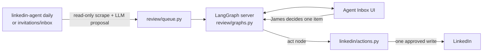

> **Initial Prompt:** Draft updates to README.md and add or update ARCHITECTURE.md or per-stack docs where useful. Ask before resolving ambiguity. Do not change production behavior

# Architecture

This repo has two stacks: a **Python agent stack** (the LinkedIn automation itself) and an **Azure infra stack** (Bicep/`azd` IaC that provisions the Azure OpenAI resource the agents call). This document describes both, plus known issues to be aware of when making changes.

- [Python Agent Stack](#python-agent-stack)
  - [Purpose](#purpose)
  - [Entry points](#entry-points)
  - [Shared modules](#shared-modules)
  - [Review workflow](#review-workflow)
  - [Write safety](#write-safety)
  - [Data layer](#data-layer)
  - [Templates](#templates)
- [Azure Infra Stack](#azure-infra-stack)
  - [Purpose](#purpose-1)
  - [Modules](#modules)
- [Known Issues / Tech Debt](#known-issues--tech-debt)
- [Unenforced Rules](#unenforced-rules)

## Python Agent Stack

### Purpose

AI-assisted LinkedIn triage. An LLM (via [Pydantic AI](https://ai.pydantic.dev/)) proposes what to do with each invitation and conversation. James decides each item in [Agent Inbox](https://github.com/langchain-ai/agent-inbox), and only then does a [Playwright](https://playwright.dev/python/) browser session carry out that one decision on LinkedIn. The LLM never acts on LinkedIn itself.

### Entry points

All Python code lives in one installable package, `src/linkedin_agent/`, run through a single command, `uv run linkedin-agent <invitations|inbox|daily>` (`cli.py`). Importing any module has no side effects: `.env` is loaded and logging is set up when a command starts.

| File | Role |
|---|---|
| `src/linkedin_agent/invitations.py` (`linkedin-agent invitations`) | Scans pending invitations, asks an `Agent` to propose accept/ignore/undecided for each, and queues every new one for review in Agent Inbox. Also closes reviews for invitations that are no longer pending on LinkedIn. Never clicks Accept or Ignore. See [Running the invitation manager](../README.md#running-the-invitation-manager). |
| `src/linkedin_agent/inbox.py` (`linkedin-agent inbox`) | Scans conversations until it is caught up, asks a separate `Agent` to score reply urgency (1-10) and suggest a reply, and queues every conversation where the other person spoke last. Also closes reviews for conversations James replied to or archived on LinkedIn. In interactive runs it opens the highest-priority thread. Never writes to LinkedIn. See [Running the inbox manager](../README.md#running-the-inbox-manager). |
| `src/linkedin_agent/daily.py` (`linkedin-agent daily`) | Unattended daily sync, scheduled by launchd at 06:30 (`deploy/launchd/`): recovers stuck reviews, closes items already handled on LinkedIn, then proposes new items. Read-only on LinkedIn. See [Daily unattended workflow](../README.md#daily-unattended-workflow). |
| `src/linkedin_agent/review/graphs.py` | The two LangGraph graphs, `invitation_review` and `message_review`, served by `uv run linkedin-agent server` (`langgraph dev` with `deploy/langgraph.json`). Each pauses for a human decision and then runs an `act` node that performs exactly that decision through `linkedin/actions.py`. |
| `evals/run.py` (`uv run python -m evals.run`) | Runs `pydantic_evals` regression checks (`CorrectDecisionEvaluator`, `IsInstance`) against the invitation-decision agent using cases from `evals/invitation_cases.yaml`. It evaluates against whatever `MODEL_BACKEND` resolves to (`ollama` by default). Developer-only; not part of the package. |

### Shared modules

| File | Role |
|---|---|
| `src/linkedin_agent/llm.py` | Every model backend, built on demand (env vars are read then, not at import). Keeps the two workflows' Azure OpenAI client setups side by side behind an explicit `azure_variant`. |
| `src/linkedin_agent/linkedin/session.py` | `open_linkedin`: the logged-in session, login detection, the cross-process LinkedIn lock, and the write guard. |
| `src/linkedin_agent/linkedin/pages.py` | Read-only invitation and conversation scraping helpers with their selector fallback chains. |
| `src/linkedin_agent/linkedin/models.py` | Shared domain models (`Invitation`, `InvitationDecision`, `ConversationMessage`, `InboxMessage`, `MessageRanking`). |
| `src/linkedin_agent/linkedin/guard.py` | The write guard: a network-layer block on LinkedIn messaging writes, a composer-input guard, and `safe_click`, which refuses destructive-looking controls unless an approval covers them. Safety-critical. |
| `src/linkedin_agent/linkedin/actions.py` | The only code that changes anything on LinkedIn: accept/ignore an invitation, send a reply, archive a conversation. Each action re-checks LinkedIn first and counts as done only once LinkedIn confirms it. Called only from `review/graphs.py`. Safety-critical. |
| `src/linkedin_agent/review/queue.py` | LangGraph SDK client for Agent Inbox threads: enqueue, de-duplicate, close as superseded, and recover stuck reviews. |
| `src/linkedin_agent/runtime.py` | Shared errors (`LoginRequiredError`, `HealthCheckError`), `ReviewCounts`, console logging setup, and macOS notifications. |

### Review workflow

1. The daily sync (or a manual manager run) scrapes LinkedIn read-only, asks the LLM for a proposal, and queues a review thread per new item.
2. James decides in Agent Inbox: Accept or Ignore an invitation; Accept, Edit, or Ignore a message.
3. The graph's `act` node performs that decision immediately. Ignore on a message archives the conversation.
4. If the action fails, or LinkedIn changed since the item was queued (for example a new incoming message), nothing is sent and the item returns to the inbox with a note.
5. The next daily sync closes items James handled directly on LinkedIn, and re-queues a conversation when a new message arrives.

### Write safety

Every LinkedIn write needs an explicit human decision on that one item:

* The LLM agents have no tools; they only return structured proposals.
* Every browser context gets the write guard. Scraping and sync contexts get no approval, so every messaging write, including read receipts, is blocked and nothing is marked read.
* An action context gets one `ApprovedAction`, which allows exactly one primary write of the approved kind (send or archive), confirmed against LinkedIn's real endpoints.
* A reply sends the exact submitted text once.
* `tests/unit/test_no_message_writes.py` enforces the architecture: no clicks outside `safe_click`, no typing outside `linkedin/actions.py`, action functions called only from `review/graphs.py`, and LLM agents with no tools. `tests/unit/test_linkedin_guard.py`, `tests/unit/test_linkedin_actions.py`, and `tests/playwright/test_linkedin_actions.py` cover the guard and actions.

### Model backend selection

Both workflows build their Pydantic AI model with `llm.build_model(backend, azure_variant)`, selectable per command via a `--model-backend {ollama,openai,azure,fallback}` CLI flag or the `MODEL_BACKEND` env var:

* **`ollama` (default)** — local [Ollama](https://ollama.com) server via Pydantic AI's `OllamaModel`/`OllamaProvider`, targeting `OLLAMA_MODEL` (default `gemma3:latest`, the 4B tag) at `OLLAMA_BASE_URL` (default `http://localhost:11434/v1`). No Azure credentials are read or required in this mode.
* **`openai`** — the OpenAI API (`OPENAI_API_KEY`, `OPENAI_MODEL`). See [Configuring OpenAI models](../README.md#configuring-openai-models).
* **`azure`** — Azure OpenAI only, using each script's existing (and intentionally divergent — see Known Issues) client-setup code.
* **`fallback`** — `pydantic_ai.models.fallback.FallbackModel(ollama_model, azure_model)`: tries Ollama first, falls back to Azure OpenAI on failure. **Requires Azure credentials to be present at startup** (not just on failure) since `FallbackModel` constructs both underlying models eagerly. Manually tested (not a regression test) that a connection-refused Ollama endpoint triggered fallback correctly with the library's default `fallback_on=(ModelAPIError,)` on `pydantic-ai==1.107.6` — this relies on how that version wraps connection errors, which is not a documented guarantee, so treat it as verified-for-this-version rather than a permanent contract; a regression test would be a good follow-up if this behavior matters for production use.

Azure client construction is lazy (inside `build_azure_model()`), so importing either module, or running with the default `ollama` backend, never requires `AZURE_TENANT_ID`/`AZURE_OPENAI_*` env vars to be set. See [`docs/reports/local-model-serving-for-gemma3.md`](reports/local-model-serving-for-gemma3.md) for the research behind choosing Ollama over llama.cpp/LM Studio/MLX/vLLM.

### Data layer

No database. All state is file-based. Runtime state lives outside the repo, in one per-user folder returned by `linkedin_agent.runtime.state_dir()`: `~/Library/Application Support/linkedin-agent` on macOS, `$XDG_STATE_HOME/linkedin-agent` (default `~/.local/state/linkedin-agent`) elsewhere, or `$LINKEDIN_AGENT_HOME`. Every checkout and worktree therefore shares one login and one Agent Inbox, and nothing generated at runtime lands in the repo (#47).

* `browser/state.json` — cached Playwright browser storage state (cookies/session) written after a manual LinkedIn login, so subsequent runs skip re-authenticating. Used by every LinkedIn session through `linkedin.session.open_linkedin`.
* `browser/linkedin.lock` — the cross-process lock that keeps the daily sync, manager runs, and Agent Inbox actions from using LinkedIn at the same time.
* `langgraph/.langgraph_api/` — the LangGraph dev server's store: Agent Inbox review history and the de-duplication state the daily sync relies on. Deleting it brings back handled items. `langgraph dev` always writes `.langgraph_api/` to its working directory, so `linkedin-agent server` starts it from `langgraph/` with `--config deploy/langgraph.json` (graphs referenced by module name).
* `logs/` — `daily_run.log` and launchd output. Disposable.
* `scripts/migrate_runtime_state.py` moves the pre-#47 in-repo locations (`playwright/.auth/`, `.langgraph_api/`, `logs/`) into this folder without overwriting anything.
* `evals/invitation_cases.yaml` — eval dataset consumed by `evals/run.py`; also appended to at runtime by `linkedin-agent invitations --record-eval-cases`.
* `.env` — Azure OpenAI endpoint/deployment config, generated post-provision by `deploy/azure/infra/write_dot_env.sh` / `.ps1`, which write to the repo-root `.env`; `.env.example` documents every variable (see [Azure Infra Stack](#azure-infra-stack)); also where `MODEL_BACKEND`/`OLLAMA_BASE_URL`/`OLLAMA_MODEL` may optionally be set (these are not `azd`-provisioned outputs, so they are not written by the postprovision hooks).

### Templates

None. LLM system prompts are inline Python strings in `invitations.py` (invitation accept/ignore rules) and `inbox.py` (message urgency scoring rules) — there is no shared prompt-template mechanism.

### Dependency management

Runtime and development dependencies are declared in `pyproject.toml` and resolved reproducibly through
the committed `uv.lock`. Local, test, evaluation, and application commands run through `uv run`;
`uv sync --all-groups` creates and updates the managed `.venv`.

## Azure Infra Stack

### Purpose

Provisions the Azure OpenAI resource (`gpt-5.5` deployment, per `deploy/azure/infra/main.bicep`) that both workflows call, using the Azure Developer CLI (`azd`). Run `azd` from `deploy/azure/`.

### Modules

* `deploy/azure/azure.yaml` — `azd` project manifest; wires the `postprovision` hooks.
* `deploy/azure/infra/main.bicep` — subscription-scoped: creates a resource group, an Azure OpenAI (Cognitive Services) account with a `gpt-5.5` deployment, and a `Cognitive Services OpenAI User` role assignment.
* `deploy/azure/infra/main.parameters.json` — `azd` parameter bindings for the Bicep template.
* `deploy/azure/infra/write_dot_env.sh` / `.ps1` — `postprovision` hooks that write `AZURE_TENANT_ID`, `AZURE_OPENAI_SERVICE`, `AZURE_OPENAI_ENDPOINT`, `AZURE_OPENAI_CHAT_DEPLOYMENT`, and `AZURE_OPENAI_CHAT_MODEL` into `.env`.
* `.github/workflows/azure-dev.yaml` — CI provisioning via `azd provision --no-prompt` (in `deploy/azure`) on push to `main`, using federated OIDC credentials.
* `.github/workflows/template-validation.yaml` — a Microsoft-internal sample-template validation check, inherited from the upstream `Azure-Samples/python-ai-agent-frameworks-demos` template this repo was forked from. Its own header comment says it can be deleted in forks; recommend removing it as part of a future cleanup pass (not done here, to avoid touching CI behavior).

## Known Issues / Tech Debt

* **The two workflows use different Azure OpenAI client setups.** `llm.build_azure_model("invitations")` uses `base_url=AZURE_OPENAI_ENDPOINT + "/openai/v1"` with an async `AzureDeveloperCliCredential`; `llm.build_azure_model("inbox")` uses the bare endpoint with a sync `DefaultAzureCredential`. James chose to preserve both in #48 rather than unify them. This is documented, intentional-until-decided tech debt (see `.github/instructions/python.instructions.md`).
* **Heavy reliance on CSS selectors / `aria-label` scraping**: invitation cards and conversations in `linkedin/pages.py` (`INVITATION_CARD_SELECTORS`, `get_invitation_info`, `extract_conversation_messages`), the conversation list in `inbox.py` (`get_inbox_messages`), and the message composer, send button, and archive menu in `linkedin/actions.py`. LinkedIn markup changes will silently break scraping with no compile-time signal. LinkedIn's write endpoints can change too; the guard and actions match the endpoints confirmed against live traffic on 2026-10-17.
* **No automated live coverage**: fixture-based Playwright tests cover scraping, the guard, and the actions, unit tests cover the review graphs, queue, and daily cadence, and the evals (`evals/run.py`) check invitation-decision quality. Behavior against the live LinkedIn site is verified only manually.
* **`ruff` `line-length = 1000`** (`pyproject.toml`) effectively disables line-length linting.

## Unenforced Rules

* The invitation accept/ignore business rules ("always ignore wealth/financial advisors", "always ignore coaches", "ignore recruiters") live entirely in the LLM system prompt in `invitations.py` — there is no deterministic keyword/regex check backing these up if the model misclassifies.
* `.pre-commit-config.yaml` defines lint/format/whitespace hooks that CI doesn't run as such. CI (`.github/workflows/ci.yaml`) does run `ruff check`, `ruff format --check`, and `pytest`, plus the Agent Inbox UI tests, lint, and typecheck, on pull requests.
* `evals/invitation_cases.yaml` has no schema validation on write — `run_and_log_agent` in `invitations.py` appends freeform YAML with no deduplication.
