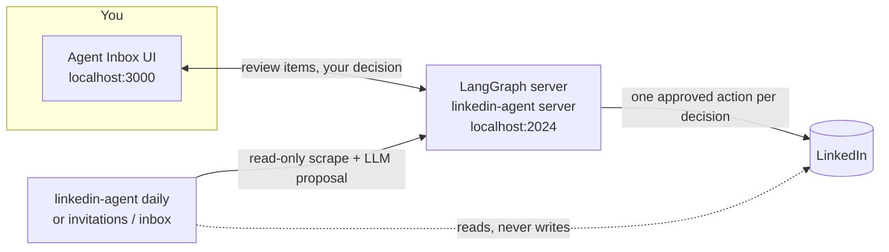

# Daily workflow

How to use this project day to day: the agent reads LinkedIn and proposes, you decide each item in Agent Inbox, and your decision is carried out on LinkedIn immediately. Read [SAFETY.md](SAFETY.md) first: it lists what the agent can and can't do to your account.

- [How the pieces fit](#how-the-pieces-fit)
- [One-time setup](#one-time-setup)
- [Every morning](#every-morning)
- [What each button does](#what-each-button-does)
- [Troubleshooting](#troubleshooting)

## How the pieces fit



| Process | What it does | Must be running | How to check it's up |
|---|---|---|---|
| LangGraph server (`uv run linkedin-agent server`) | Holds the review queue and carries out your decisions on LinkedIn | Whenever you review or a sync runs | `curl -s localhost:2024/ok` prints `{"ok":true}` |
| Agent Inbox UI (`cd deploy/agent-inbox && yarn dev`) | Where you review and decide | Only while you review | Open <http://localhost:3000> |
| Daily sync (`uv run linkedin-agent daily`) | Queues new invitations and messages; closes items you handled directly on LinkedIn | Once a day (launchd at 06:30, or by hand) | `tail ~/Library/Application\ Support/linkedin-agent/logs/daily_run.log` |

## One-time setup

1. Install and configure the project: follow [Getting started](../README.md#getting-started) in the README, then `cp .env.example .env` and choose a model backend ([Ollama](../README.md#configuring-ollama-models) by default, or [OpenAI](../README.md#configuring-openai-models)/[Azure](../README.md#configuring-azure-ai-models)).
2. Install the Agent Inbox UI (Node.js and yarn): `git submodule update --init && (cd deploy/agent-inbox && yarn install)`.
3. Log in to LinkedIn once with a visible browser, which caches the session in the runtime folder:

    ```shell
    uv run linkedin-agent invitations --num-to-process 1
    ```

4. Start the server and the UI (see the table above). In the UI, open **Settings**, then **Add Inbox** twice, both with Deployment URL `http://localhost:2024`: one with Graph ID `invitation_review`, one with `message_review`.
5. Optional: run the server and the daily sync automatically with launchd: [`deploy/launchd/README.md`](../deploy/launchd/README.md).

## Every morning

- [ ] The server is up: `curl -s localhost:2024/ok`. If not: `uv run linkedin-agent server`.
- [ ] New items are queued. With launchd this happened at 06:30 (you get a notification with the counts). Otherwise run `uv run linkedin-agent daily`.
- [ ] Start the UI (`cd deploy/agent-inbox && yarn dev`) and open <http://localhost:3000>.
- [ ] Work through **invitation_review**, then **message_review**. Each item shows who it is, the agent's proposal and reasoning, a link to LinkedIn, and what each button will do.
- [ ] Anything that comes back with **⚠️ Last attempt failed** needs a second look: read the note, check LinkedIn if it says so, and decide again.

Manual runs end with the counts and the exact next step, for example `Next: review 3 new invitation item(s) in Agent Inbox`.

## What each button does

Every decision acts on LinkedIn **right away**, for that one item only. The item closes once LinkedIn confirms; if the action fails or LinkedIn changed since the item was queued, nothing is done and the item comes back with a note.

| Inbox | Button | On LinkedIn |
|---|---|---|
| `invitation_review` | **Accept** | Accepts the invitation |
| `invitation_review` | **Ignore** | Ignores the invitation |
| `message_review` | **Accept** | Sends the suggested reply, exactly as shown, once |
| `message_review` | **Edit** | Sends your edited text instead, exactly as written, once |
| `message_review` | **Ignore** | Archives the conversation (it moves to LinkedIn's Archived folder) |

Things the agent never does: delete, report, block, leave, recall, or act in bulk. A new incoming message after you replied or archived puts the conversation back in the inbox on the next sync. Newsletter invitations are left pending.

## Troubleshooting

| Symptom | Cause | Fix |
|---|---|---|
| `error: Can't reach the LangGraph server at http://localhost:2024.` | The server isn't running | `uv run linkedin-agent server` |
| `error: Ollama isn't reachable at http://localhost:11434/v1.` | Ollama isn't running (default backend) | `ollama serve` (and `ollama pull gemma3`), or `--model-backend openai` |
| `error: Missing required OPENAI_API_KEY …` or `… Azure OpenAI environment variable(s) …` | The chosen backend isn't configured | Set the values in `.env` (see `.env.example`), or pick another backend |
| `error: The LinkedIn login expired.` / notification "LinkedIn login needed" | The cached session expired | Run `uv run linkedin-agent invitations --num-to-process 1` without `--headless` and log in |
| `error: Another LinkedIn task … is using LinkedIn.` | The daily sync or an Agent Inbox action holds the LinkedIn lock | Wait a few minutes and retry |
| Item comes back: "Another LinkedIn task is running; try again in a few minutes." | Your decision waited for the lock (a sync was running) | Choose again in a few minutes |
| Item comes back: "A new message arrived since this was queued; nothing was sent." | The conversation changed before your reply went out | Read the new message and decide again |
| Agent Inbox shows nothing, or old items | The UI points at the wrong server or Graph ID, or the server was started with a different `LINKEDIN_AGENT_HOME` | Check **Settings** (URL `http://localhost:2024`, Graph IDs above); always start the server with `uv run linkedin-agent server` |
| Daily notification: "N LinkedIn write attempt(s) blocked by the safety guard" | Normal: LinkedIn tried to send read receipts while the sync read your messages | Nothing to do; this is the guard keeping reads read-only |
| Daily run exits with code 1 and "health check failed" | A scrape returned nothing (LinkedIn markup may have changed), so nothing was closed | Re-run once; if it persists, the selectors need updating (see the Playwright Selector Maintainer agent) |
