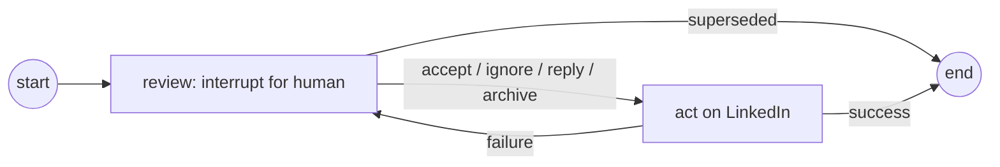

# Agent Inbox live actions

## Intent

Agent Inbox is where James reviews every LinkedIn invitation and conversation that needs a decision. Today a
decision made there does nothing on LinkedIn until a batch job or a manual `--apply-inbox-decisions` run picks
it up, and message replies are never sent (they're printed for copy-paste). That makes the inbox feel like a
to-do list rather than a control surface.

The new rule: **clicking a decision in Agent Inbox is the action.** The LinkedIn change happens right away, and
the item leaves the inbox once it's done. The daily job only keeps the inbox in sync with LinkedIn: it pulls in
new items and closes items already handled elsewhere.

### Why the safety rules change

The existing guardrails (`linkedin_guard.py`, the "no message is ever sent" invariant in
`.github/instructions/python.instructions.md`, `tests/unit/test_no_message_writes.py`) were written to stop an
LLM from acting on LinkedIn without James knowing. That intent stays. What changes is the mechanism: actions
are now allowed **when James explicitly chose them in Agent Inbox**, not banned outright.

## Goals

- An invitation **Accept** or **Ignore** in Agent Inbox clicks that button on LinkedIn immediately, then the
  item leaves the inbox.
- A message **reply** submitted in Agent Inbox sends exactly that text in that LinkedIn conversation
  immediately, then the item leaves the inbox.
- A message **Ignore** in Agent Inbox archives the conversation on LinkedIn (which also marks it read and
  clears its notification) immediately, then the item leaves the inbox.
- The daily job queues:
  - every pending LinkedIn invitation not already in the inbox;
  - every conversation in the main (non-archived) LinkedIn inbox where the other person sent the latest
    message and that message hasn't already been handled.
- The daily job closes inbox items James already handled on LinkedIn directly:
  - an invitation no longer pending on LinkedIn (accepted or declined there, or withdrawn);
  - a conversation where James sent the latest message;
  - a conversation James archived on LinkedIn.
- A new incoming message in a conversation James already replied to or archived puts it back in the inbox.
- If a LinkedIn action fails, the item stays visible in Agent Inbox with the error and can be retried. Nothing
  disappears unless the action really happened.

## Non-goals

- Bulk actions, auto-accept rules, or any action without a per-item human decision.
- Changing how the LLM decides or ranks (prompts, models, urgency scoring).
- Changing the opportunity message analysis work (#45). That design isn't in this repo yet; leave a comment on
  #45 that its "Agent Inbox behavior remains unchanged" criterion is stale and that its scraper must take the
  same LinkedIn lock (below).
- Real-time detection of new LinkedIn messages. New items still arrive on the daily schedule.

## Anti-goals

These would make the work a failure even if every goal technically passes:

- **The LLM sends, accepts, ignores, or archives anything on its own.** The LLM only suggests. Every LinkedIn
  write traces back to one explicit human click on one specific item.
- **A message is sent twice**, or sent with text different from what James submitted.
- **An item vanishes from the inbox without its LinkedIn action having happened** (silent failure).
- **The scraping/sync job writes to LinkedIn.** Reading conversations must not mark them read, archive them, or
  send anything, exactly as today.

## User experience

### Invitations (`invitation_review`)

| James does | LinkedIn result | Inbox result |
|---|---|---|
| **Accept** in Agent Inbox | Invitation accepted | Item closed |
| **Ignore** in Agent Inbox | Invitation ignored (sender isn't notified) | Item closed |
| Accepts or declines on LinkedIn | — | Daily job closes the item |
| Nothing | — | Item stays |

### Messages (`message_review`)

| James does | LinkedIn result | Inbox result |
|---|---|---|
| **Accept** (suggested reply as-is) | That exact text sent | Item closed |
| **Edit** then submit | The edited text sent | Item closed |
| **Ignore** | Conversation archived (marked read, notification cleared) | Item closed |
| Replies on LinkedIn | — | Daily job closes the item |
| Archives on LinkedIn | — | Daily job closes the item |
| Other person sends a new message later | — | Conversation queued again by the next daily job |

**Accept** is offered only when there's a non-empty suggested reply. An unscored conversation (no suggestion)
offers **Edit** and **Ignore** only, so an empty message can never be sent.

### When an action fails

The item goes back to waiting in Agent Inbox with a visible note at the top of its description, for example
"⚠️ Last attempt failed: LinkedIn login expired. Log in with a visible browser, then try again." James can
retry by choosing again. A macOS notification (existing `unattended.notify`) is also sent for failures.

## Architecture

### Actions run inside the review graph

Each review graph in `review_graph.py` gains an action step after the human decision:

- The action runs in the LangGraph server process (`langgraph dev`, kept alive by
  `scheduling/com.personal-linkedin-agent.langgraph-server.plist`) the moment Agent Inbox resumes the thread.
  No separate watcher or poller.
- On failure the graph loops back to the review step with the error stored in state, so the thread is
  `interrupted` again and shows up in the inbox with the failure note. It never ends in LangGraph's `error`
  status, which Agent Inbox hides in a separate view.
- On success the thread ends; Agent Inbox no longer lists it. The thread is kept (never deleted), with the
  outcome recorded in thread metadata (`outcome`: `accepted`, `ignored`, `sent`, `archived`, or `superseded`)
  for history and run reports.
- `superseded` (sent by the daily job) ends the thread without any LinkedIn action, as today.

### Re-check LinkedIn before acting

Time passes between queuing an item and James clicking. Every action first re-reads the current LinkedIn state
for that one item, and **never acts on a stale picture**:

| Situation found at action time | Result |
|---|---|
| Invitation no longer pending | Close as `superseded` (nothing left to decide) |
| Message **Ignore**, but a newer incoming message arrived | Don't archive. Back to the inbox, with the new message shown and a note |
| Message reply, but the other person wrote again since | Don't send. Back to the inbox, with the new message shown and a note |
| Message reply, but James already replied on LinkedIn with different text | Don't send. Back to the inbox with a note (James may still want to send it) |
| Message reply, and James's latest message already equals the approved text | Record `sent`, don't send again (see double-send rule) |

"Back to the inbox" means the same path as a failure: the graph loops back to its review step with the note in
state, so the item stays visible.

### Crash recovery

If the server dies mid-action (sleep, restart, hot reload), the thread can be left in LangGraph's `error` or
`busy` state, which Agent Inbox doesn't show. Interrupted actions are **never replayed automatically**. A
recovery check runs at the start of every daily job and every action. For any review thread stuck in `error`,
or `busy` for more than 10 minutes, it brings the item back as a pending review with the note "The last attempt
was interrupted; check LinkedIn and choose again." It does this by superseding the stuck thread and queuing a
fresh one for the same key. James clicks again; the re-check and double-send rules make that safe.

### Browser session for actions

- Actions open a **headless** Chromium context from `playwright/.auth/state.json`, the same cached login the
  scripts use. If the session has expired, the action fails with a "log in again" error (it never opens a login
  window from the server).
- A cross-process file lock (e.g. `playwright/.auth/linkedin.lock`) serializes LinkedIn browser sessions
  between the server's actions and the daily job, so two automations never drive LinkedIn at once. An action
  waits for the lock with a timeout of a few minutes, then fails visibly if it can't get it.
- Each action does the smallest possible navigation: invitations open the invitation manager and find the card
  by profile URL; messages open the stored conversation URL.

### Guardrails, restated

`linkedin_guard.py` keeps its job but becomes **default-deny with a single-use, per-item allowance**:

- **Sync/scrape contexts** (daily job, any read): unchanged. Every messaging write is blocked at the network
  layer and in the UI, including read receipts and presence updates, so reading never marks anything read.
- **Action contexts** (one approved item): the guard is installed with an `ApprovedAction` that permits only:
  -   the action write itself (accept, ignore, send, or archive), once;
  - the incidental writes LinkedIn fires for that one conversation while doing it (read receipts, delivery
    acknowledgements, typing and presence updates);
  - on that one conversation URL or invitation profile.

  Replying or archiving therefore marks the conversation read, as it would in the LinkedIn UI. Everything
  else stays blocked, including any second send.
- **Message sends are bound to the approved text.** The action types exactly the reply string stored in the
  resumed thread state and verifies the composer contains exactly that text before submitting. A mismatch fails
  the action.
- **No double sends.** Before sending, the action checks the conversation: if James's latest message already
  equals the approved text (a previous attempt sent it but crashed before recording success), it records `sent`
  and skips sending.
- The LLM agents keep having no tools. Only the graph's action step can act, and only after an `interrupt`
  returns a human response.
- Every attempted and completed action is logged with item, action, and result (never message text in full; a
  short preview plus a SHA-256 of the sent text is enough).

### Daily job (sync only)

`daily_run.py` becomes a sync job: close stale items, then queue new ones.

**Deduplication is against currently pending items only.** Today `enqueue_review` skips a key if any thread
ever existed for it, open or closed. That would hide a re-sent invitation from someone previously ignored, and
a new message whose text repeats an earlier one (for example "Thanks!"). The queue condition itself already
reflects LinkedIn state (still pending, latest message from them, not archived), so a closed item can't come
back unless LinkedIn says it needs a decision again. Rules:

- At most one pending item per invitation profile and per conversation.
- Message items are keyed by conversation URL. If a pending item exists and a newer incoming message has
  arrived, supersede it and queue a fresh item showing the new message.
- Run reports keep their current `new` / `already queued` / `superseded` counts, computed from pending items.

- **Invitations:** scan the full pending list. Queue new ones as today (key = profile URL). Supersede pending
  items whose profile is no longer listed. As today, only after a full, non-empty scan.
- **Messages:** scan the main (non-archived) inbox. Queue conversations where the latest message is from
  someone else and no item for that conversation is pending. Supersede pending items when:
  - James sent the latest message;
  - the conversation has a newer incoming message (it's replaced by a fresh item showing the new message);
  - the conversation is archived.
- **No LinkedIn writes.** The "apply" steps are removed from the daily job. `--mode apply` and the every-2-hours
  `apply-run` launchd job are retired (removed from `scheduling/install.sh` and docs).
- **Legacy items:** threads resolved under the old flow but never applied (`status=idle`, no `applied`
  metadata) are not acted on automatically. The daily job lists them in its summary so James can re-decide.
  Re-queueing them as fresh reviews is acceptable.

### Removed or reworked

- `invitations_manager.py --apply-inbox-decisions` and `inbox_manager.py --apply-inbox-decisions`: removed
  (actions are live). Their LinkedIn-clicking code moves into shared action functions the graph calls.
- `inbox_manager.py`'s "print the approved reply to paste" behavior: removed.
- `finalize_dismissed_messages`: removed (dismiss now archives live).

## Constraints

- Python, `uv`, Playwright, LangGraph, Pydantic AI, and the self-hosted Agent Inbox submodule, as today. No new
  services.
- Keep the multi-selector fallback chains for scraping, and use the same approach for new action selectors
  (send button, archive control), each with fixture tests in `tests/playwright/`.
- Runs on James's Mac. Actions only work while the LangGraph server is up, which is already a precondition for
  using Agent Inbox at all.
- Follow `.github/instructions/python.instructions.md` for lint/format and test commands.

## Docs and tests to update

- `.github/instructions/python.instructions.md` and `.github/copilot-instructions.md`: replace the "no message
  is ever sent" invariant with the rule above (human-approved, per-item, single-use; LLM never acts).
- `README.md`: "Human review with Agent Inbox", "No message is sent or deleted…", and "Daily unattended
  workflow" sections; `scheduling/README.md`.
- `tests/unit/test_no_message_writes.py`: rewrite from "no writes anywhere" to "writes only inside the
  guarded action module, only under an `ApprovedAction`". Keep the AST checks for every other file.
- New tests:
  - graph routing: each human response leads to the right action, failure loops back to review, superseded
    ends the thread;
  - the approved-text binding and double-send check;
  - archive detection in sync;
  - fixture tests for the send/archive selectors;
  - the guard allowing exactly one approved write and blocking everything else.

## Left to the builder

- How the graph's action step gets its LinkedIn helpers (a new module such as `linkedin_actions.py` is
  reasonable, given there's no shared module today).
- Exact selectors and the archive UI path on LinkedIn, discovered against live markup and captured as fixtures.
- How archived status is detected during sync (conversation page indicator, archived filter, or absence from the
  main list after a full scan). Pick whichever is reliable, and fail open (keep the item) when unsure.
- Lock implementation and timeouts.
- Wording of failure notes and notifications.

## Calls made without James

These were decided in the design, not by James, and are worth checking:

- Actions run inside the LangGraph graph rather than a separate watcher.
- Failures loop back into the inbox rather than ending in LangGraph's error state.
- The every-2-hours apply job is retired.
- Legacy resolved-but-unapplied items are surfaced for re-decision, not auto-applied.
- Accept is hidden when there's no suggested reply.
- Actions re-check LinkedIn first and send the item back to the inbox, rather than acting, when things changed.
- Interrupted actions are never replayed; the item comes back for a fresh click.
- Action contexts allow LinkedIn's incidental read/typing/presence writes for that one conversation, so replying
  or archiving marks it read.
- Deduplication only looks at pending items, and message items are keyed by conversation.
