# LinkedIn Opportunity Message Analysis

## Intent

Add a separate command-line capability that turns relevant LinkedIn recruiting messages into a trustworthy, reusable dataset about the skills and experience expected of machine learning engineers and similar roles.

The first release establishes the analysis foundation: collect messages incrementally from the Focused inbox and the Archived folder, identify distinct relevant job opportunities, extract and normalize the skills and experience mentioned in each opportunity, retain the raw and structured data locally, and generate an evidence-backed local report for a selected period.

The design prioritizes extraction quality and traceability over model cost and runtime. The initial import is limited to the previous 30 days so the collection and analysis approach can be validated before processing more history.

## Goals

- Analyze conversations from LinkedIn's Focused inbox and its Archived folder. Since #46, choosing Ignore for a conversation in Agent Inbox archives it on LinkedIn, so declined recruiter messages, a large share of the useful data, live in Archived rather than Focused.
- Identify recruiting and job opportunities for machine learning engineering, AI or LLM engineering, applied scientist, research engineer, and MLOps or machine learning platform roles.
- Exclude unrelated roles, including data engineering opportunities, and messages that contain too little company or role detail to support useful analysis.
- Treat clearly distinct roles in the same LinkedIn conversation as separate opportunities.
- Count each normalized skill or experience at most once per distinct opportunity.
- Retain the original message text, source metadata, structured extraction, model provenance, and report history locally.
- Produce a Markdown report containing:
  - counts for each normalized skill or experience;
  - a hybrid taxonomy that preserves stable core groups while allowing new groups;
  - aggregate counts for each group;
  - the contributing opportunities and supporting message snippets.
- Process new or changed content incrementally after the initial 30-day import.
- Use structured LLM outputs and dedicated analysis passes where they improve accuracy.

## Non-Goals

- Comparing two periods, plotting multi-period trends, or generating narrative market forecasts.
- Writing anything to LinkedIn: sending, replying, archiving, accepting invitations, or marking messages as read. Collection is strictly read-only.
- Changing the existing human-review workflow or its live Agent Inbox actions (#46).
- Replacing the urgency-ranking behavior in `inbox_manager.py`.
- Analyzing LinkedIn's Other inbox or non-LinkedIn sources.
- Treating data-engineering-only roles as relevant.
- Building a web interface, notebook, or Agent Inbox analysis view.
- Automatically deleting or expiring retained message data.
- Processing more than the initial 30-day history until the approach has been reviewed and refined.

## User Experience

The new entry point will be a separate script:

```shell
uv run python message_analyzer.py
```

On the first run, the command will:

1. Open LinkedIn through the shared read-only session, `linkedin_pages.open_linkedin`, which reuses `playwright/.auth/state.json`, holds the cross-process LinkedIn lock, and installs the write guard.
2. Open LinkedIn Messaging, select the Focused inbox, and collect conversations from the previous 30 days.
3. Switch to the Archived folder and collect its conversations from the same window.
4. Identify distinct recruiting opportunities and classify their relevance.
5. Extract, verify, and normalize skills and experience from relevant opportunities.
6. Update the local taxonomy.
7. Write a Markdown report and print its path.

Later runs will collect messages newer than the last successful collection watermark, with a bounded overlap to catch delayed or edited content. Reporting can be rerun without scraping or repeating opportunity-level extraction.

Proposed command options:

```shell
uv run python message_analyzer.py collect
uv run python message_analyzer.py report
uv run python message_analyzer.py run
uv run python message_analyzer.py run --initial-days 30
uv run python message_analyzer.py report --start 2026-09-01 --end 2026-09-30
uv run python message_analyzer.py run --model-backend azure
```

`run` is the default and performs collection, analysis, and report generation. `collect` only scrapes and persists raw conversation data; it does not invoke analysis agents or update the taxonomy. `report` operates only on retained structured data and therefore does not require LinkedIn or model access unless taxonomy regeneration is explicitly requested.

## Architecture

### Separate End-to-End CLI

`message_analyzer.py` will own this workflow rather than adding an analysis mode to `inbox_manager.py`. The existing inbox manager scans recent conversations only until it is caught up, keeps just the last three messages of each, and immediately ranks reply urgency. Longitudinal analysis requires complete opportunity context, incremental persistence, idempotent reprocessing, and report generation, which are a separate responsibility.

The new script will follow the established entry-point convention for logging, CLI parsing, and model setup, which each script still implements independently. LinkedIn browser access is the exception: since #46 it is shared, and the collector must use it rather than launching Playwright itself:

- `linkedin_pages.open_linkedin(headless, unattended, lock_timeout=...)` for the logged-in session, the cross-process lock, login detection, and the write guard. The collector never passes an `approval`.
- `linkedin_guard.safe_click` for every click.
- The read-only helpers in `linkedin_pages.py` (for example `get_logged_in_user_name` and `is_linkedin_conversation_url`) where they fit.

It must never import `linkedin_actions`. Its Azure client setup will follow the known-working pattern in `invitations_manager.py`, not the intentionally divergent setup in `inbox_manager.py`.

### Processing Stages

```mermaid
flowchart LR
    A[Focused and Archived collection] --> B[Local message store]
    B --> C[Opportunity segmentation and relevance]
    C --> D[Grounded skill and experience extraction]
    D --> E[Extraction verification]
    E --> F[Canonical normalization]
    F --> G[Hybrid taxonomy update]
    G --> H[Deterministic aggregation]
    H --> I[Markdown report with evidence]
```



Each stage persists its inputs, outputs, prompt version, model identifier, and status. A failed stage remains visible and retryable; it must not be converted into an empty or successful result.

New messages automatically mark their affected conversation and opportunities for reanalysis. A changed prompt version, model configuration, or normalization algorithm marks prior results stale but does not automatically incur model cost; the user must request reanalysis explicitly.

## Collection

### Read-Only Session and Locking

Collection must never change anything on LinkedIn. Opening a conversation normally makes LinkedIn send read receipts, delivery acknowledgements, and "mark all as seen" requests. Without protection, collecting would silently mark recruiter messages as read and clear notifications James hasn't seen.

- The collector opens LinkedIn only through `open_linkedin` without an approval. That installs the write guard, which aborts every messaging write (including read receipts) and blocks typing in the message composer.
- Every click goes through `safe_click`. The collector never types, presses keys, or calls `linkedin_actions`.
- The LinkedIn analysis agents have no tools. They only read stored text.

`open_linkedin` holds the shared LinkedIn lock for the whole session, so collection never overlaps the daily sync or an Agent Inbox action. While a collection is running, an Agent Inbox action waits up to five minutes and then returns a retryable "Another LinkedIn task is running" note. To keep that visible and short:

- the collector passes a short `lock_timeout` and fails clearly with a nonzero exit when another LinkedIn task holds the lock, instead of waiting;
- it releases the lock as soon as collection is committed, before any model analysis starts;
- the documentation recommends not running the initial 30-day import while actively reviewing in Agent Inbox.

### Focused Inbox and Archived Folder

The collector reads two folders, in this order:

1. **Focused:** it explicitly activates the Focused inbox before reading conversation cards.
2. **Archived:** it then switches to the Archived folder. This is where conversations go when James chooses Ignore in Agent Inbox (#46) or archives them on LinkedIn.

It will use resilient selector and accessibility-label fallback chains rather than a single CSS selector. If either folder cannot be identified, the run will fail clearly instead of analyzing an unknown inbox.

LinkedIn's Archived folder doesn't record whether a conversation came from Focused or Other, so it may contain non-recruiting threads. The opportunity relevance pass already excludes those, and they are reported as irrelevant rather than counted. A conversation is identified by its canonical URL, so one that moves from Focused to Archived between runs is updated in place, never collected twice.

For each folder, the collector will scroll the conversation list until it reaches the run's cutoff or LinkedIn exposes no additional conversations. Each opened conversation will retain:

- the canonical conversation URL;
- the folder it was last seen in (Focused or Archived);
- participant names;
- message author;
- raw message text;
- the best available machine-readable timestamp;
- the timestamp text shown by LinkedIn;
- collection time;
- stable content hashes.

The initial run stops at 30 days. Later runs begin from the last successful collection watermark with a configurable overlap, initially seven days. Existing message hashes make overlapping collection idempotent.

### Conversation History

For a newly discovered conversation, the collector will load enough history to cover the active 30-day window and any surrounding context needed to understand the role. For an existing conversation, it will collect new visible messages and combine them with retained local history before opportunity segmentation.

Messages older than the collection cutoff may be retained as bounded explanatory context, but they cannot establish an opportunity for the reporting period or contribute counted skills unless the opportunity's first recruiting message falls within that period.

LinkedIn timestamps can be incomplete or relative. The collector will prefer DOM timestamp attributes when available, retain the displayed timestamp unchanged, and record when a report date relies on collection time rather than a parsed message time.

## Local Persistence

Private analysis data will live under `.linkedin-analysis/`, which will be added to `.gitignore`.

```text
.linkedin-analysis/
├── analysis.sqlite3
└── reports/
    └── 2026-09-01-to-2026-09-30.md
```

SQLite is available in the Python standard library and is sufficient for the first release. The schema will preserve:

| Entity | Purpose |
|---|---|
| `runs` | Collection and analysis run status, cutoffs, prompt versions, and model provenance |
| `conversations` | Canonical LinkedIn thread identity, participants, and the folder it was last seen in |
| `messages` | Raw message text, authorship, timestamps, hashes, and collection metadata |
| `opportunities` | Distinct role opportunities segmented from conversations |
| `opportunity_messages` | Evidence-bearing messages associated with each opportunity |
| `extractions` | Raw extracted skills and experiences with exact evidence references |
| `canonical_items` | Normalized skill or experience identities |
| `opportunity_items` | Deduplicated canonical items present in each opportunity |
| `taxonomy_groups` | Stable core groups and newly introduced groups |
| `taxonomy_memberships` | Canonical-item membership in taxonomy groups |
| `analysis_state` | Successful incremental watermarks and schema/prompt versions |

An opportunity's stable identity will be derived from its conversation, the first recruiting message assigned to that distinct role, and a persisted source-message identity. When LinkedIn exposes no durable message ID, the source identity will use the conversation, author, best timestamp, message position, and original content hash. Later observations that appear to be edits will be stored as message revisions linked to the original logical message rather than silently replacing it. Reprocessing the same messages therefore updates the existing opportunity instead of creating another count.

Schema migrations will be explicit and versioned. An incompatible schema must fail with an actionable message rather than being recreated and losing personal data.

## LLM Analysis

### Model Policy

Accuracy is the primary priority. The analyzer will default to the configured Azure OpenAI deployment and support an explicit OpenAI backend. Model names and deployments remain configuration, so the workflow can adopt newer capable models without source changes.

Every agent will use Pydantic AI structured output with bounded timeouts and explicit token limits. The stored provenance will include backend, model identifier, prompt version, and analysis timestamp.

### Opportunity Segmentation and Relevance

The first agent pass receives the retained messages for one conversation and returns zero or more distinct opportunities. Each opportunity includes:

- company and role title when available;
- the message identifiers that establish the opportunity;
- first and last relevant message times;
- role family;
- `relevant`, `irrelevant`, or `insufficient_detail`;
- a concise reason grounded in the messages.

Machine learning engineer, AI or LLM engineer, applied scientist, research engineer, and MLOps or machine learning platform roles are relevant. Data scientist, data-engineering-only, and mixed roles in which machine learning is not the primary function are irrelevant. A relevant opportunity must identify the role and contain concrete skills or experience expectations; the hiring company may remain confidential. Opportunities below this threshold are retained as `insufficient_detail` and excluded from counts.

Separating opportunities before extraction prevents a recruiter who discusses multiple roles in one thread from collapsing those roles into one count.

### Grounded Extraction

For each relevant opportunity, a dedicated extraction agent returns structured items with:

- item type, such as skill, technology, domain experience, responsibility, seniority, or qualification;
- the source wording;
- a proposed canonical label;
- an exact supporting quote;
- the source message identifier;
- optional context describing how the item is expected or used.

The initial report will combine these item types into one enumerable list while retaining their types for later filtering.

The application will verify that every quoted snippet occurs in the referenced raw message. Unsupported items will be marked invalid and excluded, not silently accepted.

### Verification

Because accuracy is prioritized over cost, a second agent pass will review each opportunity's proposed extraction against its source messages. It can confirm, reject, or correct items, but every retained item must still have an exact source quote.

Extraction failures and unresolved verification results will appear in a report-quality section so missing analysis is visible.

### Canonical Normalization

Normalization will map equivalent wording to a stable canonical item, such as mapping "PyTorch experience" and "experience with PyTorch" to `PyTorch`. The normalizer receives existing canonical labels before proposing a new one.

Deterministic code will enforce one count per canonical item per opportunity. Repeated mentions, follow-up messages, and multiple evidence snippets remain available for traceability but cannot inflate the count.

Canonical merges must preserve aliases and historical identities. A later normalization improvement updates memberships without deleting the source extraction.

### Hybrid Taxonomy

The taxonomy agent receives:

- the canonical items in the selected report period;
- their counts;
- the existing active taxonomy;
- representative evidence and item types.

It should reuse stable groups when they still fit, introduce a new group when the existing taxonomy would distort the data, and avoid renaming groups without a clear reason. Examples might include `Programming and Frameworks`, `Model Development`, `Production ML and MLOps`, `Cloud and Infrastructure`, and `Domain Experience`, but these are examples rather than a fixed initial taxonomy.

Group membership and taxonomy revisions are persisted. Reports show the taxonomy version so future trend work can distinguish data changes from taxonomy changes.

Each canonical item has one primary taxonomy group in the first release. A group's count is the number of distinct opportunities containing at least one item in that group, not the sum of its member-item counts. This prevents one opportunity containing several related skills from inflating the group total.

## Report

The generated Markdown report will use a stable heading hierarchy and contain:

1. Run metadata, date range, models, prompt versions, and taxonomy version.
2. Coverage and quality statistics:
   - Focused and Archived conversations inspected, counted separately;
   - distinct opportunities found;
   - relevant, irrelevant, and insufficient-detail counts;
   - extraction or verification failures.
3. Canonical skill and experience counts, sorted by opportunity count.
4. Grouped counts using the active hybrid taxonomy.
5. Evidence details for each canonical item:
   - contributing company and role;
   - LinkedIn conversation link;
   - supporting message snippet.
6. Excluded and incomplete opportunities with reasons.

Counts will be computed in deterministic Python and SQL, not by asking an LLM to count. The LLM supplies classification, extraction, normalization proposals, and grouping; the application performs deduplication and arithmetic.

Reports contain private message snippets and will remain under the ignored `.linkedin-analysis/` directory.

An opportunity belongs to the reporting period containing its first recruiting message. Follow-ups in later periods update the retained opportunity but do not make the same opportunity a new observation in those periods.

Historical reports use the taxonomy version requested by the user and default to the current active taxonomy. Every report records that version, so a prior report remains interpretable even when a regenerated report uses a newer taxonomy.

Repeated reports for the same date range are timestamped rather than overwritten:

```text
.linkedin-analysis/reports/2026-09-01-to-2026-09-30--2026-10-17T043500Z.md
```

## Reliability and Error Handling

- A missing login, missing Focused tab or Archived folder, LinkedIn markup change, database migration problem, or required model configuration will terminate the affected stage with a clear error.
- If another LinkedIn task holds the shared lock, collection exits nonzero with a clear message and collects nothing.
- Per-conversation scraping or analysis failures will be recorded with enough context to retry and will make the run partially failed rather than successful.
- The successful collection watermark advances only after collected data is committed.
- The successful analysis watermark advances only after all selected opportunities reach a terminal analysis state.
- Interrupted runs can resume without duplicating messages, opportunities, or counts.
- No broad exception handler will turn failures into empty classifications or zero-count reports.
- Model outputs are validated through Pydantic models and evidence checks before persistence.
- A partially failed `run` will generate a clearly labeled partial report when useful results exist and exit with a nonzero status. If no trustworthy results exist, it will skip report generation and exit nonzero.

## Testing and Evaluation

### Unit Tests

- SQLite schema creation, migration, upsert, and idempotent rerun behavior.
- Stable opportunity identity and separate opportunities within one conversation.
- One canonical item counted once per opportunity.
- Exact evidence quote validation.
- Canonical alias merging without source-data loss.
- Stable-group reuse and new-group addition.
- Report aggregation and private output location.
- Watermarks do not advance on partial failure.
- The write-safety architecture test (`tests/unit/test_no_message_writes.py`) scans the new `message_analysis/` package as well as root scripts, so the collector cannot click, type, or use write selectors outside the guard.

### Playwright Fixture Tests

Extend the inbox fixtures to cover:

- selecting the Focused inbox and the Archived folder;
- failing clearly when either folder cannot be found;
- a conversation that moved from Focused to Archived between runs is updated, not duplicated;
- opening conversations sends no LinkedIn write, because every messaging write is blocked by the guard;
- selector fallback behavior;
- scrolling conversation history;
- extracting full message content and machine-readable timestamps;
- stopping at the initial cutoff;
- collecting new messages during an overlapping incremental run.

### LLM Evaluations

Add a synthetic, non-personal evaluation dataset covering:

- relevant machine learning engineering roles;
- related roles that should be included;
- data engineering roles that should be excluded;
- insufficient-detail recruiter messages;
- multiple opportunities in one conversation;
- repeated mentions that should count once;
- aliases that should normalize together;
- unsupported extraction attempts.

The evaluation checks structured validity, relevance classification, opportunity separation, grounded evidence, and normalized-item expectations. Live personal messages must not be committed as fixtures or evaluation cases.

## Security and Privacy

- Collection is read-only. The write guard is installed on every browser context the collector uses, with no approval, so no message is sent, archived, or marked read.
- Raw messages and reports remain local and git-ignored.
- The command will clearly state that message content is sent to the configured model provider.
- Logs will avoid printing full message bodies by default.
- No LinkedIn authentication state, raw message data, database, or generated report will be committed.
- Conversation URLs are retained for traceability but validated as LinkedIn messaging URLs before rendering.

## Acceptance Criteria

- A first run collects up to 30 days of conversations from the Focused inbox and the Archived folder and stores raw messages locally.
- Conversations ignored in Agent Inbox (and therefore archived on LinkedIn) are still collected and analyzed.
- Collection never writes to LinkedIn: nothing is sent, archived, or marked read, enforced by the write guard and covered by `tests/unit/test_no_message_writes.py`.
- Collection fails fast, without waiting, when another LinkedIn task holds the shared lock.
- A later run processes new or changed messages without duplicating previously stored data.
- Distinct roles in one conversation become distinct opportunities.
- Data-engineering-only and insufficient-detail opportunities are excluded from skill counts with visible reasons.
- Relevant opportunities produce evidence-backed structured skill and experience items.
- Every retained item points to an exact quote in a stored source message.
- Equivalent labels can normalize to one canonical item.
- Each canonical item contributes no more than one count per opportunity.
- The report shows canonical counts, hybrid grouped counts, opportunity sources, and evidence snippets.
- Existing `inbox_manager.py` urgency ranking and Agent Inbox behavior remain unchanged.
- Private raw data and generated reports are ignored by Git.

## Builder Decisions

The builder may choose:

- exact class and function names inside `message_analyzer.py`;
- the initial SQLite migration mechanism, provided it is explicit and preserves data;
- the exact Markdown table layouts;
- timeout and retry defaults consistent with the existing project;
- the precise selector fallback order after inspecting current LinkedIn markup and adding fixture coverage.

The builder may not replace the evidence requirement, deterministic counting, separate-opportunity behavior, the Focused-and-Archived collection scope, the read-only shared session, or private local storage with weaker alternatives.

## Revisions

| Date | Change |
|---|---|
| 2026-10-17 | Updated after #46 merged. Collection now also reads the Archived folder, because Ignore in Agent Inbox archives conversations. It must use the shared read-only session (`open_linkedin`, the write guard, and the LinkedIn lock) and never write to LinkedIn, including read receipts. |
